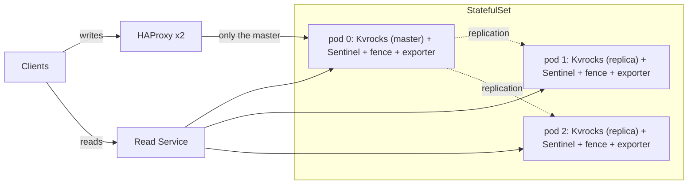

# Kvrocks Helm chart

A Helm chart that runs [Apache Kvrocks](https://github.com/apache/kvrocks) with one master, its replicas and automatic failover, behind a write endpoint that always reaches the master.

## Introduction

Kvrocks is a Redis-compatible database that keeps its data on disk with RocksDB. It replicates asynchronously from a master to its replicas, but nothing in Kvrocks itself promotes a replica when the master dies.

As of November 2026, I found no chart that I would trust for that:

- there is no official chart;
- `kvrocks-controller` only manages cluster mode, which requires cluster-aware clients and gives up namespaces;
- of the two operators I looked at, one is no longer maintained and the other is standalone only.

Kvrocks does work with Redis Sentinel. Unfortunately, upstream never runs a real Sentinel in its CI, so "works" was mostly a claim. On top of that, my clients are plain Redis clients: they know a host, a port and a password, not Sentinel.

Hence this chart. Sentinel decides who the master is, HAProxy gives clients one address that follows it, and the failure scenarios in `tests/e2e` are what backs the claim that it holds.

## Architecture



- A StatefulSet of 3 pods. Each pod runs Kvrocks and `kvrocks_exporter`, with two sidecars: a Sentinel (the Valkey image) and a small fencing loop.
- HAProxy is the write endpoint. It sends writes to the pod that a majority of Sentinels names as master and actually reaches, with a reply to their pings in the last 2 s, and only if that pod also reports itself as master. With no such majority it refuses connections rather than guess.
- The fencing loop pauses the writes of a master that a majority of Sentinels no longer confirms, as when it is cut off from the other pods. Kvrocks has no `min-replicas-to-write`, and without this the connections already open to such a master would keep writing to it until the partition heals. Those writes are lost when it rejoins as a replica. It reaches the other Sentinels by their last known address, so that a cluster DNS outage does not make it pause a healthy master.
- Everything goes by pod hostnames, never by IP: pod IPs change on every restart.
- `sentinel.conf` and a writable copy of `kvrocks.conf` live on the data volume. The role of a pod never comes from a ConfigMap, because Sentinel rewrites it at every failover.
- Sentinel and the fencing loop are native sidecars, hence Kubernetes 1.29 or later: Kubernetes only stops them once Kvrocks has exited, so they are still there while the master hands its role over.

Each pod decides its role when its container starts:

1. It asks the Sentinels of its peers and reads the view its own Sentinel saved on the volume. Between the two, the higher Sentinel config epoch wins, so a Sentinel that slept through a failover cannot mislead the others.
2. With no view anywhere, it is a first install: pod 0 is the first master.
3. A pod whose volume is empty never starts as master while a peer holds data. It waits for Sentinel to fail over to that peer, then joins as a replica.

When a master has to stop (rolling update, drain), its `preStop` hook hands the role over first:

1. It pauses client writes.
2. It checks that every replica Sentinel could promote has received every write. Sentinel ranks replicas with offsets it read up to ten seconds earlier, so it may pick any of them.
3. It asks Sentinel to fail over, keeps writes paused until the new master is announced, then demotes itself.

If a replica is behind, the handover gives up and writes stay paused until the pod stops. The failover that follows is then slower, about 15 s instead of 3 s, but it promotes an up-to-date replica and loses nothing (scenario `handover_aborted_on_stop`).

A replica only becomes ready once a majority of Sentinels could promote it. After a restart, Sentinel needs a DNS answer with the new address of the pod before it can reach it again, which took about 15 s in one Kind run where I timed it. Without that condition, a rolling update would stop the master while no Sentinel could promote the replica that had just restarted. When fewer than a majority of Sentinels answer at all, as during a DNS outage, every one that answers must be able to promote it.

## Installation

As of 2026-11-16 the chart is not published to a registry yet, so it installs from a clone of this repository. Once a version is tagged, the CI pushes it to `oci://ghcr.io/kinoute/charts/kvrocks`.

1. Create the password. It must not contain whitespace, double quotes or backslashes.

   ```bash
   kubectl create secret generic kvrocks-auth --from-literal=password='change-me'
   ```

2. Install the chart.

   ```bash
   helm install db ./helm/kvrocks --set auth.existingSecret=kvrocks-auth
   ```

3. Wait for the pods. You should end up with three Kvrocks pods `4/4` (Kvrocks, the exporter and the two sidecars) and two HAProxy pods `1/1`. An HAProxy pod only becomes ready once it can reach a master, so `1/1` means writes are being served.

   ```bash
   kubectl get pods -l app.kubernetes.io/instance=db
   ```

4. Check that a write goes through.

   ```bash
   helm test db
   ```

**Important:** pick `replicaCount` and the password before you install. Changing either afterwards is not handled by the chart, see [Caveats](#caveats).

Requirements:

- Kubernetes 1.29 or later.
- As many schedulable nodes as `replicaCount`: by default each Kvrocks pod needs a node of its own (`podAntiAffinity: hard`).
- Kvrocks 2.16.0 or later in `replication` mode, the first version with `CLIENT PAUSE WRITE`. The chart refuses an older `image.tag` it can read, and the handover script refuses to run on an older Kvrocks pinned by digest.
- A password without whitespace, quotes or backslashes: HAProxy sends it in its health checks.

## Usage

### Endpoints

For a release named `db`:

| Purpose | Address |
| --- | --- |
| Writes, always the master | `db-kvrocks:6379` |
| Reads, any ready pod (may be slightly stale) | `db-kvrocks-read:6379` |
| Sentinel, for clients that speak it (master name `kvrocks`), not with TLS | `db-kvrocks-headless:26379` |

### Main values

Every value is documented in [`helm/kvrocks/values.yaml`](helm/kvrocks/values.yaml), and `values.schema.json` rejects unknown keys. The ones you are most likely to set:

| Value | Default | What it does |
| --- | --- | --- |
| `architecture` | `replication` | `standalone` runs a single Kvrocks, without Sentinel or HAProxy |
| `auth.existingSecret` | | Secret that holds the password, under the key `auth.secretKey` |
| `persistence.size` | `10Gi` | Size of each pod's volume, see [Sizing](#sizing). A StatefulSet cannot change it afterwards |
| `podAntiAffinity` | `hard` | `soft` lets two Kvrocks pods share a node, for clusters with fewer nodes than pods |
| `config` | `use-rsid-psync: "yes"` | Extra `kvrocks.conf` settings |
| `sentinel.downAfterMilliseconds` | `10000` | How long a master must be unreachable before Sentinel fails over |
| `fencing.enabled` | `true` | Pauses the writes of a master that a majority of Sentinels no longer confirms |
| `metrics.serviceMonitor.enabled` | `false` | Scrapes the exporters and HAProxy with the Prometheus Operator |
| `metrics.prometheusRule.enabled` | `false` | Installs the alerts |
| `networkPolicy.enabled` | `false` | Restricts who can reach the pods |
| `tls.enabled` | `false` | Clients connect over TLS, with a client certificate by default, see [TLS](#tls) |

### TLS

TLS covers the clients only. Kvrocks takes them on `port` (6379) over TLS, and with `tls.authClients` (the default) only with a certificate signed by the CA. Everything between the pods of the release stays in clear on `tls.internalPort` (6666): replication, Sentinel, the checks of HAProxy, the fencing and the exporter.

```yaml
tls:
  enabled: true
  existingSecret: db-kvrocks-tls # kubernetes.io/tls: tls.crt and tls.key
  ca:
    secret: db-kvrocks-ca # the CA that signed the client certificates
    key: ca.crt
```

- **The server certificate must cover the names clients use**: `db-kvrocks` and `db-kvrocks-read`, in their short and `.<namespace>.svc.cluster.local` forms, plus any name used from outside the cluster. HAProxy passes the TLS connection through without opening it, so clients see the certificate of Kvrocks whichever endpoint they use. Most clients check the name: one that connects to a given pod needs `*.db-kvrocks-headless.<namespace>.svc.cluster.local` as well. The `serverAuth` usage is enough.
- **Python 3.13 and later verify strictly.** They refuse, with `certificate verify failed`, a certificate without an Authority Key Identifier or a CA without a key usage. A company PKI usually sets both, a quick `openssl` one-liner often does not. `openssl verify -x509_strict -CAfile ca.crt tls.crt` tells beforehand.
- **The port in clear cannot be closed.** Kvrocks always listens in clear as well, so the chart moves that port to `tls.internalPort` and installs a NetworkPolicy, even with `networkPolicy.enabled: false`, that opens it to the pods of the release only. This needs a network plugin that enforces NetworkPolicy. Without one, the port stays reachable from the cluster, behind the password.
- **Sentinel is not available to clients.** It speaks in clear, so the same NetworkPolicy keeps it inside the release. Clients go through the write endpoint.
- **Renewing a certificate restarts the pods.** Kvrocks does not notice that its files changed. With `tls.reloader: true`, the StatefulSet carries the annotation of [Reloader](https://github.com/stakater/Reloader), which rolls the pods when either Secret changes. A rolling update hands the master over without losing a write. Without Reloader, run `kubectl rollout restart statefulset/db-kvrocks` after the renewal.
- **`helm test` needs a client certificate** under `tls.authClients`: a `kubernetes.io/tls` Secret named in `tls.clientSecret`. Without it, the test is not installed.

The scenario `tls_clients` checks that a client with a certificate from the CA gets in, and that clients without a certificate, with a certificate from another CA, in clear, or on the port in clear from outside the release do not. Every other scenario runs with TLS on too, except in `make e2e-quick`.

### Moving the master before maintenance

```bash
kubectl exec <master pod> -c kvrocks -- /scripts/kvrocks-switchover.sh
```

If it prints `handed the master role over to ...`, the master has moved and no acknowledged write was lost. If it gives up, a replica was behind or Sentinel refused: writes resume on the same master and nothing changed.

The output of the handovers run by the `preStop` hook is not in the container logs. Each pod keeps its last ones on its volume:

```bash
kubectl exec <pod> -c kvrocks -- cat /var/lib/kvrocks/handover.log
```

Do not use a plain `SENTINEL FAILOVER` for that. Sentinel promotes a replica while the old master still accepts writes for about a second, and those writes are thrown away: between 4 500 and 8 500 acknowledged writes in each of a dozen end-to-end runs. The script loses none.

### Alerts

`KvrocksInstanceDown`, `KvrocksMasterCountWrong`, `KvrocksReplicationBroken`, `KvrocksReplicasMissing`, `KvrocksBackgroundErrors`, `KvrocksDiskUsageHigh` and `KvrocksWriteEndpointDown`. They are unit-tested with `promtool` in `tests/prometheus`.

`KvrocksWriteEndpointDown` follows the routing condition of HAProxy itself: it fires when no HAProxy pod sees a pod that a majority of Sentinels names as master and reaches, and that reports itself as master. That covers every pod down, the Sentinels losing their majority or their link to the master, and a fenced master.

## Operations

### Sizing

Each pod holds a full copy of the data. Give its volume at least twice the size of the data, plus the RocksDB write-ahead log:

- a full sync downloads a complete checkpoint before it replaces the old database, so a replica needs room for both copies at once ([`storage.cc`](https://github.com/apache/kvrocks/blob/v2.17.0/src/storage/storage.cc));
- every pod keeps its write-ahead log for replicas that fall behind, up to `rocksdb.wal_size_limit_mb` (16 GB by default) or `rocksdb.wal_ttl_seconds` (3 h). After a burst of writes, that log weighs as much as what was written.

A full sync happens when a pod is new or lost its volume, and when a former master comes back with writes the new master never got. Its duration grows with the data.

With 10 GiB written on a real cluster (see [On a real cluster](#on-a-real-cluster)), each pod held 13.6 GB of data and, right after the writes, 12 to 15 GB of archived log on top of it. A full sync of those 13.6 GB took 5 minutes. As a rule of thumb, give each volume twice the data plus 16 GB.

Set `resources` too: with none, the pods run as BestEffort and are the first evicted under memory pressure.

### Migrating from a standalone Kvrocks

The chart starts pod 0 as master when it finds data on its volume and no other pod holds any. Moving a standalone Kvrocks therefore comes down to putting its data on that volume before the first install (scenario `install_from_existing_data`):

1. Stop the writes to the standalone instance, or accept losing those made after the copy.
2. Copy its data directory, the one that contains `db/`, to a volume claim named `data-<release>-kvrocks-0` in the target namespace. A clone from a `VolumeSnapshot` of the old volume is the fastest way when the storage class supports it.
3. Install the chart with that release name. Pod 0 starts as master on the copied data, and the other pods copy it with a full sync.
4. Point the clients at the write endpoint.

The configuration and the password of the old instance are not reused: the chart writes its own `kvrocks.conf` next to the data.

### Backup and restore

The chart does not take backups. Two ways that fit it:

- A `VolumeSnapshot` of a replica's volume. RocksDB recovers from its write-ahead log, so a snapshot of a running replica is consistent.
- A job that attaches to the write endpoint's master as an extra replica, waits for the sync, and copies the files. Start it with `slave-priority 0`, or Sentinel may promote it.

To restore, follow the migration above with the backup as the data.

### Rotating the password

There is no rolling rotation: during a rolling restart, pods with the new password could no longer talk to pods with the old one. The procedure takes a short write outage:

1. Update the Secret.
2. Delete every Kvrocks and HAProxy pod of the release at once: `kubectl delete pod -l app.kubernetes.io/instance=<release>`.
3. The pods come back with the new password and pick the master from the state they saved, as after a power cut (scenario `full_outage`). Update the clients.

This procedure itself has not been run end to end.

## What a failure costs

Measured on 2026-11-16 with `make e2e`, on a Kind cluster of 3 workers running in Docker Desktop with 4 CPUs. Four clients write as fast as they can through HAProxy over persistent connections, then every acknowledged key is read back from the write endpoint and from each pod. "Longest interruption" is the longest stretch without a single acknowledged write.

| Scenario | Acknowledged writes | Lost | Longest interruption |
| --- | ---: | ---: | ---: |
| Handover run by hand | 130 766 | 0 | 3.2 s |
| Handover with one replica dead | 831 239 | 0 | 3.2 s |
| Handover refused, one replica behind | 154 242 | 0 | 2.6 s |
| Plain `SENTINEL FAILOVER` | 116 578 | 6 476 | 0.7 s |
| Rolling update | 498 323 | 0 | 3.4 s |
| Drain of the master's node | 232 428 | 0 | 1.2 s |
| Rolling restart of HAProxy | 344 287 | 0 | 0.5 s |
| Master pod deleted with `--force` | 102 386 | 0 | 2.8 s |
| Master's node killed | 253 049 | 4 | 16.5 s |
| Master pod cut off from the network | 134 760 | 4 | 13.9 s |
| Master cut off from the other pods only | 188 976 | 19 374 | 10.3 s |
| Replica volume lost | 187 268 | 0 | 0.8 s |
| Master volume lost | 120 284 | 0 | 13.7 s |

When the master's pod is deleted, Kubernetes recreates it within 3 s, on the same volume but with a new address. On Kind, the Sentinels reach it again before they declare it down and nothing fails over. When the node dies instead, Sentinel waits 10 s (`sentinel.downAfterMilliseconds`) then promotes a replica.

Where a vanished pod address drops packets instead of refusing them, as with Cilium, the Sentinels can stay stuck on the old address for longer than that, and fail over even though the pod came back. HAProxy, which resolves the new address at once, used to send writes to the recreated pod meanwhile, and those were lost with the failover: 1 848 acknowledged writes in one run on a real cluster. It now waits for a majority of Sentinels to reach the pod, so either they do in time and nothing fails over, or they fail over to a replica that holds every acknowledged write. See [On a real cluster](#on-a-real-cluster).

The 19 374 writes of the isolated master are the two seconds before it was fenced: HAProxy still reached it, so the connections already open kept writing to it. Without fencing, it would have kept them for the whole partition.

Three more scenarios write 2 000 keys, then kill every node at once and check that all of them are still on every pod: a plain full outage, an outage where the former master that missed a failover restarts first, and one where pod 0 comes back first with an empty volume. None lost a key.

### On a real cluster

Measured on 2026-11-16 with `make e2e-cluster`, on a managed Kubernetes 1.34 cluster of 3 nodes with 1.8 CPU and 6 GB each, Cilium and network block storage, clients over mutual TLS. Only the scenarios that leave the nodes alone run there. The load is the same as on Kind; fewer writes go through because every one of them crosses a real network.

| Scenario | Acknowledged writes | Lost | Longest interruption |
| --- | ---: | ---: | ---: |
| Handover run by hand | 55 137 | 0 | 2.1 s |
| Plain `SENTINEL FAILOVER` | 46 482 | 2 668 | 2.2 s |
| Rolling update | 171 372 | 0 | 3.8 s |
| Upgrade that changes the scripts | 191 556 | 0 | 1.8 s |
| Rolling restart of HAProxy | 160 737 | 0 | 0.2 s |
| Master pod deleted with `--force` | 53 504 | 0 | 14.0 s |
| Replica volume lost | 124 943 | 0 | 0.2 s |
| Master volume lost | 87 328 | 0 | 16.4 s |
| Handover with the NetworkPolicy on | 55 330 | 0 | 2.1 s |

Two differences with Kind. A new volume takes longer to come than Sentinel takes to fail over, so the master that lost its volume restarts as a replica and the empty-volume guard has nothing to do. And a master pod deleted with `--force` usually ends in a failover, for the reason above: out of four runs, the Sentinels reached the recreated pod in time once (3 s without writes) and failed over three times (about 14 s), without losing a write.

With data: `large_dataset` wrote 10 GiB shaped like a production workload, 30.4 million keys of which 90 % small hashes, through HAProxy over mutual TLS. It took 57 minutes: the nodes, busy compacting, were the limit, not the chart. Then:

- each pod held 13.6 GB of SST files, plus 12 to 15 GB of archived write-ahead log on the pods that had taken the writes live;
- a replica that lost its volume copied everything back in 5 min 7 s, about 45 MB/s;
- a replica restarted on its full volume was ready in 20 s, by partial resync;
- a handover and a rolling update lost no write, paused them for 2.2 s and 3.8 s, and caused no full sync.

## Caveats

- **Replication is asynchronous.** When the master crashes, the last writes it acknowledged and had not sent to a replica yet are lost.
- **Fencing is not instant.** A master cut off from its peers keeps taking writes on the connections already open to it for about two seconds, the time the fencing loop waits before it concludes that no majority of Sentinels confirms it any more. Those writes are lost.
- **A slow start can cost a full sync.** A pod picks its role before RocksDB opens. If opening a large database takes longer than `sentinel.downAfterMilliseconds`, Sentinel may fail over meanwhile, and the pod starts as a master nobody routes to. Sentinel then demotes it, and it copies the whole database again. No write is lost.
- **Fencing has a cost.** A healthy master also stops taking writes when two Sentinels out of three are down. HAProxy already refuses new connections in that case.
- **A rolling update can move the master several times.** Kubernetes restarts the pods from the highest ordinal down, and Sentinel may hand the role to the next pod to restart. Each move pauses writes for about 3 s without losing any, but a rolling update can take up to three of them.
- **Password rotation is not automatic.** Changing the Secret restarts nothing, and pods that restart later with the new password can no longer talk to the others. Follow [Rotating the password](#rotating-the-password).
- **Changing `replicaCount` is not handled.** Scaling down in particular can remove the pod that is the master.
- **TLS stops at the clients.** Replication and Sentinel run in clear inside the release. Encrypting them needs certificates that also carry the `clientAuth` usage: Kvrocks presents its server certificate as a client certificate when it replicates, and a `serverAuth`-only certificate is refused. It is the next thing I plan to add.
- **Not tested behind a service mesh.**
- **External replicas can be promoted.** Anything that attaches to the master as a replica, a backup job for instance, is seen by Sentinel as a candidate. Start it with `slave-priority 0`.
- **`connected_slaves` over-counts.** Kvrocks keeps counting a replica whose pod is gone until TCP gives up on it, minutes later. The alerts look at the replicas instead.
- **Versions.** Everything was tested with Kvrocks 2.17.0, Valkey Sentinel 9.0.6, HAProxy 3.2.25 and Kubernetes 1.37 on Kind, plus the scenarios that leave the nodes alone on a managed Kubernetes 1.34 with Cilium, and nothing else. Run `make e2e` again before bumping any of them.
- **Full syncs.** A handover or a rolling update does not make replicas copy the whole database again: the end-to-end scenarios check it. After a crash or a plain `SENTINEL FAILOVER`, a former master that holds writes the new one never got does copy everything again, on purpose (`use-rsid-psync yes`). On a large volume that takes a while.

## Tests

```bash
make test        # lint, Kubernetes schemas, helm-unittest, script tests, alert rules, load generator
make e2e-quick   # handover, rolling update and master crash on a local Kind cluster
make e2e         # every failure scenario
make e2e-cluster CONTEXT=<kube context>   # the scenarios that leave the nodes alone, on a real cluster
```

`make test` needs `helm` with the `unittest` and `schema` plugins, `shellcheck`, `kubeconform`, `promtool`, `yq`, `uv` and `docker`. The end-to-end targets also need `kind`, `kubectl` and `jq`. On a Linux host, raise the inotify limits first, as in [Kind's known issues](https://kind.sigs.k8s.io/docs/user/known-issues/#pod-errors-due-to-too-many-open-files): the scenarios restart nodes, and each restart takes new instances.

The scripts that run in the pods have unit tests of their own in [`tests/scripts`](tests/scripts): each runs in the image it runs in production, dash for Kvrocks and busybox for Sentinel, against a fake `redis-cli` that plays a whole cluster, unreachable hosts and DNS outages included.

The end-to-end scenarios break something while 4 clients write through HAProxy over persistent connections, then read every acknowledged key back from the write endpoint and from each pod. They live in [`tests/e2e/scenarios.sh`](tests/e2e/scenarios.sh).

On a real cluster, `make e2e-cluster` skips every scenario that kills or cuts off a node, drains one or stops cluster DNS. The rest runs in the namespace `kvrocks-ha-test` (`E2E_NAMESPACE`), deleted at the end unless `KEEP_CLUSTER=1`, and the load generator comes from `ghcr.io/kinoute/kvrocks-e2e-loadgen` (`LOADGEN_IMAGE`). `large_dataset`, which only runs when named, writes `E2E_DATASET_GIB` of data shaped like a production workload, then times a full sync and a restart on it. Size the volumes for it with `E2E_VOLUME_SIZE`:

```bash
E2E_CONTEXT=<kube context> E2E_DATASET_GIB=10 E2E_VOLUME_SIZE=40Gi tests/e2e/run.sh install large_dataset
```

## Sources

- [Apache Kvrocks](https://github.com/apache/kvrocks) and its [replication documentation](https://kvrocks.apache.org/docs/replication)
- [kvrocks_exporter](https://github.com/RocksLabs/kvrocks_exporter)
- [High availability with Redis Sentinel](https://redis.io/docs/latest/operate/oss_and_stack/management/sentinel/)
- [HAProxy configuration manual](https://docs.haproxy.org/)
