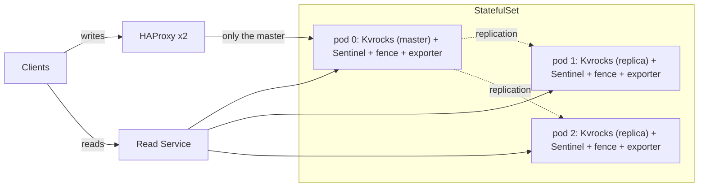

# Kvrocks Helm chart

A Helm chart that runs [Apache Kvrocks](https://github.com/apache/kvrocks) with one master, its replicas and automatic failover, behind a write endpoint that always reaches the master.

## Introduction

Kvrocks is a Redis-compatible database that keeps its data on disk with RocksDB. It replicates asynchronously from a master to its replicas, but nothing in Kvrocks itself promotes a replica when the master dies.

As of November 2026, I found no chart that I would trust for that:

- there is no official chart;
- `kvrocks-controller` only manages cluster mode, which requires cluster-aware clients and gives up namespaces;
- of the two operators I looked at, one is no longer maintained and the other is standalone only.

Kvrocks does work with Redis Sentinel. Unfortunately, upstream never runs a real Sentinel in its CI, so "works" was mostly a claim. On top of that, my clients are plain Redis clients: they know a host, a port and a password, not Sentinel.

Hence this chart. Sentinel decides who the master is, HAProxy gives clients one address that follows it, and the failure scenarios in `tests/e2e` are what backs the claim that it holds.

## Architecture



- A StatefulSet of 3 pods. Each pod runs Kvrocks and `kvrocks_exporter`, with two sidecars: a Sentinel (the Valkey image) and a small fencing loop.
- HAProxy is the write endpoint. It sends writes to the pod that a majority of Sentinels names as master, and only if that pod also reports itself as master. With no majority it refuses connections rather than guess.
- The fencing loop pauses the writes of a master that a majority of Sentinels no longer confirms, as when it is cut off from the other pods. Kvrocks has no `min-replicas-to-write`, and without this the connections already open to such a master would keep writing to it until the partition heals. Those writes are lost when it rejoins as a replica.
- Everything goes by pod hostnames, never by IP: pod IPs change on every restart.
- `sentinel.conf` and a writable copy of `kvrocks.conf` live on the data volume. The role of a pod never comes from a ConfigMap, because Sentinel rewrites it at every failover.
- Sentinel and the fencing loop are native sidecars, hence Kubernetes 1.29 or later: Kubernetes only stops them once Kvrocks has exited, so they are still there while the master hands its role over.

Each pod decides its role when its container starts:

1. It asks the Sentinels of its peers and reads the view its own Sentinel saved on the volume. Between the two, the higher Sentinel config epoch wins, so a Sentinel that slept through a failover cannot mislead the others.
2. With no view anywhere, it is a first install: pod 0 is the first master.
3. A pod whose volume is empty never starts as master while a peer holds data. It waits for Sentinel to fail over to that peer, then joins as a replica.

When a master has to stop (rolling update, drain), its `preStop` hook hands the role over first:

1. It pauses client writes.
2. It checks that every replica Sentinel could promote has received every write. Sentinel ranks replicas with offsets it read up to ten seconds earlier, so it may pick any of them.
3. It asks Sentinel to fail over, keeps writes paused until the new master is announced, then demotes itself.

If a replica is behind, the handover gives up and writes stay paused until the pod stops. The failover that follows is then slower, about 13 s instead of 3 s, but it promotes an up-to-date replica.

A replica only becomes ready once a majority of Sentinels could promote it. After a restart, Sentinel needs a DNS answer with the new address of the pod before it can reach it again, which took about 15 s on Kind. Without that condition, a rolling update would stop the master while no Sentinel could promote the replica that had just restarted.

## Installation

As of 2026-11-16 the chart is not published to a registry yet, so it installs from a clone of this repository. Once a version is tagged, the CI pushes it to `oci://ghcr.io/kinoute/charts/kvrocks`.

1. Create the password. It must not contain whitespace, double quotes or backslashes.

   ```bash
   kubectl create secret generic kvrocks-auth --from-literal=password='change-me'
   ```

2. Install the chart.

   ```bash
   helm install db ./helm/kvrocks --set auth.existingSecret=kvrocks-auth
   ```

3. Wait for the pods. You should end up with three Kvrocks pods `4/4` (Kvrocks, the exporter and the two sidecars) and two HAProxy pods `1/1`. An HAProxy pod only becomes ready once it can reach a master, so `1/1` means writes are being served.

   ```bash
   kubectl get pods -l app.kubernetes.io/instance=db
   ```

4. Check that a write goes through.

   ```bash
   helm test db
   ```

**Important:** pick `replicaCount` and the password before you install. Changing either afterwards is not handled by the chart, see [Caveats](#caveats).

Requirements: Kubernetes 1.29 or later, and Kvrocks 2.16.0 or later in `replication` mode, the first version with `CLIENT PAUSE WRITE`. The chart refuses an older `image.tag` it can read, and the handover script refuses to run on an older Kvrocks pinned by digest.

## Usage

### Endpoints

For a release named `db`:

| Purpose | Address |
| --- | --- |
| Writes, always the master | `db-kvrocks:6379` |
| Reads, any ready pod (may be slightly stale) | `db-kvrocks-read:6379` |
| Sentinel, for clients that speak it (master name `kvrocks`) | `db-kvrocks-headless:26379` |

### Main values

Every value is documented in [`helm/kvrocks/values.yaml`](helm/kvrocks/values.yaml), and `values.schema.json` rejects unknown keys. The ones you are most likely to set:

| Value | Default | What it does |
| --- | --- | --- |
| `architecture` | `replication` | `standalone` runs a single Kvrocks, without Sentinel or HAProxy |
| `auth.existingSecret` | | Secret that holds the password, under the key `auth.secretKey` |
| `persistence.size` | `10Gi` | Size of each pod's volume. A StatefulSet cannot change it afterwards |
| `config` | `use-rsid-psync: "yes"` | Extra `kvrocks.conf` settings |
| `sentinel.downAfterMilliseconds` | `10000` | How long a master must be unreachable before Sentinel fails over |
| `fencing.enabled` | `true` | Pauses the writes of a master that a majority of Sentinels no longer confirms |
| `metrics.serviceMonitor.enabled` | `false` | Scrapes the exporters and HAProxy with the Prometheus Operator |
| `metrics.prometheusRule.enabled` | `false` | Installs the alerts |
| `networkPolicy.enabled` | `false` | Restricts who can reach the pods |

### Moving the master before maintenance

```bash
kubectl exec <master pod> -c kvrocks -- /scripts/kvrocks-switchover.sh
```

If it prints `handed the master role over to ...`, the master has moved and no acknowledged write was lost. If it gives up, a replica was behind or Sentinel refused: writes resume on the same master and nothing changed.

The output of the handovers run by the `preStop` hook is not in the container logs. Each pod keeps its last ones on its volume:

```bash
kubectl exec <pod> -c kvrocks -- cat /var/lib/kvrocks/handover.log
```

Do not use a plain `SENTINEL FAILOVER` for that. Sentinel promotes a replica while the old master still accepts writes for about a second, and those writes are thrown away. In the end-to-end runs it lost between 4 500 and 8 500 acknowledged writes each time. The script loses none.

### Alerts

`KvrocksInstanceDown`, `KvrocksMasterCountWrong`, `KvrocksReplicationBroken`, `KvrocksReplicasMissing`, `KvrocksBackgroundErrors`, `KvrocksDiskUsageHigh` and `KvrocksWriteEndpointDown`. They are unit-tested with `promtool` in `tests/prometheus`.

## What a failure costs

Measured on 2026-11-16 with `make e2e`, on a Kind cluster of 3 workers running in Docker Desktop with 4 CPUs. Four clients write as fast as they can through HAProxy over persistent connections, then every acknowledged key is read back from the write endpoint and from each pod. "Longest interruption" is the longest stretch without a single acknowledged write.

| Scenario | Acknowledged writes | Lost | Longest interruption |
| --- | ---: | ---: | ---: |
| Handover run by hand | 130 766 | 0 | 3.2 s |
| Handover with one replica dead | 831 239 | 0 | 3.2 s |
| Handover refused, one replica behind | 154 242 | 0 | 2.6 s |
| Plain `SENTINEL FAILOVER` | 116 578 | 6 476 | 0.7 s |
| Rolling update | 498 323 | 0 | 3.4 s |
| Drain of the master's node | 232 428 | 0 | 1.2 s |
| Rolling restart of HAProxy | 344 287 | 0 | 0.5 s |
| Master pod deleted with `--force` | 102 386 | 0 | 2.8 s |
| Master's node killed | 253 049 | 4 | 16.5 s |
| Master pod cut off from the network | 134 760 | 4 | 13.9 s |
| Master cut off from the other pods only | 188 976 | 19 374 | 10.3 s |
| Replica volume lost | 187 268 | 0 | 0.8 s |
| Master volume lost | 120 284 | 0 | 13.7 s |

When the master's pod is deleted, Kubernetes recreates it within 3 s, before Sentinel declares it down: it comes back as master on the same volume and nothing fails over. When the node dies instead, Sentinel waits 10 s (`sentinel.downAfterMilliseconds`) then promotes a replica.

The 19 374 writes of the isolated master are the two seconds before it was fenced: HAProxy still reached it, so the connections already open kept writing to it. Without fencing, it would have kept them for the whole partition.

Three more scenarios write 2 000 keys, then kill every node at once and check that all of them are still on every pod: a plain full outage, an outage where the former master that missed a failover restarts first, and one where pod 0 comes back first with an empty volume. None lost a key.

## Caveats

- **Replication is asynchronous.** When the master crashes, the last writes it acknowledged and had not sent to a replica yet are lost.
- **Fencing is not instant.** A master cut off from its peers keeps taking writes on the connections already open to it for about two seconds, the time the fencing loop waits before it concludes that no majority of Sentinels confirms it any more. Those writes are lost.
- **Fencing has a cost.** A healthy master also stops taking writes when two Sentinels out of three are down. HAProxy already refuses new connections in that case.
- **A rolling update can move the master several times.** Kubernetes restarts the pods from the highest ordinal down, and Sentinel may hand the role to the next pod to restart. Each move pauses writes for about 3 s without losing any, but a rolling update can take up to three of them.
- **Password rotation is not handled.** Changing the Secret restarts nothing, and pods that restart later with the new password can no longer talk to the others. Plan a maintenance window, or reinstall.
- **Changing `replicaCount` is not handled.** Scaling down in particular can remove the pod that is the master.
- **No TLS yet.** Neither for clients nor for replication. It is the next thing I plan to add.
- **Not tested behind a service mesh.**
- **External replicas can be promoted.** Anything that attaches to the master as a replica, a backup job for instance, is seen by Sentinel as a candidate. Start it with `slave-priority 0`.
- **`connected_slaves` over-counts.** Kvrocks keeps counting a replica whose pod is gone until TCP gives up on it, minutes later. The alerts look at the replicas instead.
- **Versions.** Everything was tested with Kvrocks 2.17.0, Valkey Sentinel 9.0.6, HAProxy 3.2.25 and Kubernetes 1.37 on Kind, and nothing else. Run `make e2e` again before bumping any of them.
- **Full syncs.** A handover or a rolling update does not make replicas copy the whole database again: the end-to-end scenarios check it. After a crash or a plain `SENTINEL FAILOVER`, a former master that holds writes the new one never got does copy everything again, on purpose (`use-rsid-psync yes`). On a large volume that takes a while.

## Tests

```bash
make test        # lint, Kubernetes schemas, helm-unittest, alert rules, load generator
make e2e-quick   # handover, rolling update and master crash on a local Kind cluster
make e2e         # every failure scenario
```

`make test` needs `helm` with the `unittest` and `schema` plugins, `shellcheck`, `kubeconform`, `promtool`, `yq` and `uv`. The end-to-end targets need `docker`, `kind`, `kubectl` and `jq`.

The end-to-end scenarios break something while 4 clients write through HAProxy over persistent connections, then read every acknowledged key back from the write endpoint and from each pod. They live in [`tests/e2e/scenarios.sh`](tests/e2e/scenarios.sh).

## Sources

- [Apache Kvrocks](https://github.com/apache/kvrocks) and its [replication documentation](https://kvrocks.apache.org/docs/replication)
- [kvrocks_exporter](https://github.com/RocksLabs/kvrocks_exporter)
- [High availability with Redis Sentinel](https://redis.io/docs/latest/operate/oss_and_stack/management/sentinel/)
- [HAProxy configuration manual](https://docs.haproxy.org/)
